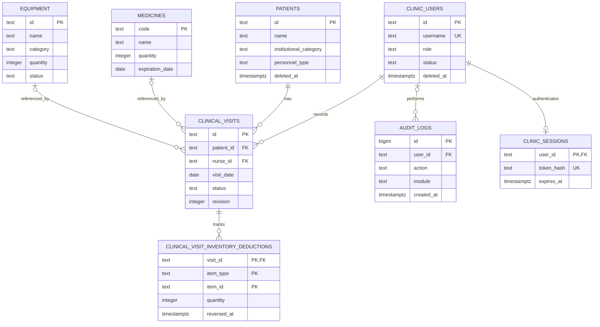

# Appendix G: Database Documentation

**System:** MQC School Clinic Management System  
**Database platform:** Supabase (PostgreSQL)  
**Schema source:** [`supabase/schema.sql`](../supabase/schema.sql)  
**Documentation basis:** Repository schema on `main`, reviewed November 17, 2026.

## G.1 Purpose and scope

This appendix documents the database structure used by the school clinic application. The schema stores staff accounts and access state, patient profiles, clinical encounters, medicine and equipment/supply inventory, audit events, clinic configuration, and compatibility/migration data. The normalized tables are the primary record structure; `clinic_state` remains for compatibility with the shared snapshot API and migration workflows.

The schema is managed in `supabase/schema.sql`. Run that file in the SQL Editor for the target Supabase project before deploying application changes that depend on the schema. Vercel deployment does not execute SQL files.

## G.2 Entity relationship overview

The diagram highlights core record relationships. Supporting security, settings, migration, and scheduled-maintenance tables are described in §G.3.

A visit's medicine and equipment references are nullable and use `ON DELETE SET NULL`; inventory deduction rows record the affected inventory key as a typed identifier rather than a foreign key. `clinical_visit_inventory_deductions` uses `(visit_id, item_type, item_id)` as its composite primary key. Patient deletion is restricted by a trigger while visits remain undeleted.

## G.3 Tables and responsibilities

| Table | Purpose and key relationships |
|---|---|
| `clinic_users` | Staff identity, role, username, bcrypt password hash, active/disabled status, appearance preference, and soft-deletion metadata. Optionally links to Supabase Auth through `auth_user_id`. |
| `patients` | Student and campus-personnel profiles, contact and guardian details, allergies, medical conditions, symptoms, and soft-deletion metadata. `institutional_category` and `personnel_type` support classifications while legacy `course` and `year_level` remain. |
| `clinical_visits` | Encounter record: patient and nurse, date/time, complaint, symptoms, medical history, vitals, assessment, interventions, treatment, disposition, contact notes, and revision/status metadata. References `patients`, `clinic_users`, `medicines`, and `equipment`. |
| `medicines` | Medicine catalog and stock quantities, unit/category, production and expiration dates, legacy batch/supplier fields, and soft-deletion metadata. |
| `equipment` | Medical equipment and medical-supply inventory, quantity, category, condition, maintenance date, availability/status, and soft-deletion metadata. Legacy equipment records are retained. |
| `clinical_visit_inventory_deductions` | Idempotent record of medicine/equipment quantities deducted for a visit, including when a deduction was reversed. Supports accurate stock restoration on visit revision, deletion, or recovery. |
| `audit_logs` | User, role, action, module, result, event details, optional lockout duration, and timestamp for operational/audit history. |
| `clinic_sessions` | Server-side session token hashes and expiration, keyed to staff accounts. Account disable/archive transitions release the account's session. |
| `clinic_login_attempts` | Failed-login counts, staged lockout state, lockout expiry, and permanent-disable timestamp keyed by username. |
| `clinic_settings` | Single-row configuration for clinic identity/contact, hours/days, patient ID prefix, inventory alerts, password length, session timeout, display preferences, and timezone. |
| `clinic_state` | Single-row JSONB snapshot retained for compatibility with the current shared-state API and legacy data. |
| `clinic_sync_meta` | Single-row marker indicating when normalized data is ready and migration/synchronization status. |
| `clinic_monthly_patient_counts` | Monthly patient-registration totals, keyed by local month start, for scheduled archive and count workflows. |
| `clinic_maintenance_runs` | Idempotency and execution record for scheduled monthly archive and six-month cleanup jobs. |
| `clinic_archive_cleanup_backups` | JSONB snapshots of eligible archived patient and inventory records, associated with a maintenance run before cleanup. |

## G.4 Key constraints and integrity rules

- Primary keys identify rows; staff usernames are unique. A Supabase Auth UUID, when present, is unique and set to null if its Auth user is removed.
- Clinical visits require a patient link, nurse name, date, time, and complaint. Patient deletion cascades to visits only where the patient-delete guard permits it; visits are normally soft-deleted.
- Visit references to a deleted nurse or inventory item are set to null to preserve the clinical record.
- Patient age is limited to 0–120 when provided. Medicine and equipment quantities cannot be negative. Visit usage quantities, when supplied, must be positive.
- Role, status, equipment category/condition, visit status, audit status, and deduction item type are constrained to supported values.
- Inventory changes are made atomically by security-definer database functions. Saves validate stock and availability, record deductions, and raise an error instead of allowing an overdraw. Revision, deletion, and restoration reverse or reapply the relevant deductions.
- Visit revision/status and timestamps are maintained in the database; soft deletion preserves recoverable records.

## G.5 Security and access

Row-level security is enabled for protected application tables. The schema intentionally provides no direct client policies for clinic data; application access is mediated by authenticated server routes and server-side Supabase credentials. The secret/service-role key must never be embedded in browser code or shared with end users.

Sensitive functions revoke default/public execution and grant execution to the server role as specified in the schema. Passwords are stored as bcrypt hashes, not plaintext. Session tokens are stored as hashes. Database credentials and application secrets belong in environment configuration, not in this appendix or committed source.

## G.6 Indexes and automated behavior

The schema includes indexes for visit lookups by patient and date, visit-date reporting, medicine expiration alerts, audit-log chronology, and archived-record cleanup. Update triggers maintain `updated_at` on relevant tables. Other triggers enforce the patient-delete guard and release sessions when an account becomes disabled or archived. Scheduled maintenance tracks each run and captures backup snapshots before eligible cleanup.

## G.7 Installation and migration

1. Create or select the intended Supabase project and verify it before applying SQL.
2. Review the current [`supabase/schema.sql`](../supabase/schema.sql); it contains both table definitions and upgrade/migration logic for existing installations.
3. Run the schema in the Supabase SQL Editor. Back up production data and use the project's normal change-control process before applying changes.
4. Configure `SUPABASE_URL` and a matching server-side `SUPABASE_SECRET_KEY` (or the documented legacy service-role variable) in the server environment. `DATABASE_URL` is used by Drizzle tooling, not the clinic API runtime.
5. Verify the application health endpoint and authenticated clinic workflows after deployment.

Schema SQL is designed for both new and existing installations, but it may perform data migrations and create/alter records. Inspect any changes that affect the target environment before execution. Do not run destructive reset or cleanup scripts as routine installation steps.

## G.8 Backup and recovery

Use Supabase's supported database backup/export process for database-level recovery, and retain access controls and encryption appropriate for sensitive student and health information. The application also offers a browser JSON backup of clinic data; that file contains sensitive information and must be stored, transferred, and deleted securely. A JSON application backup is not a substitute for a verified database backup.

The cleanup-backup table stores selected archived row snapshots for scheduled retention cleanup; it is not a complete database backup. Confirm that backups are current and that recovery procedures have been tested before performing maintenance or schema upgrades.

## G.9 Source artifacts

- [Normalized schema and database functions](../supabase/schema.sql)
- [Audit-log maintenance script](../supabase/clear_existing_audit_logs.sql) — a targeted one-time script, not a schema installation step. Review its date range and effect before use.
- [Database relationship diagram](appendix-g-database-erd.mmd)
- [Printable HTML edition](appendix-g-database-documentation.html)

---

*This appendix describes the repository schema and application design; it does not include live records, credentials, or environment-specific secrets.*
